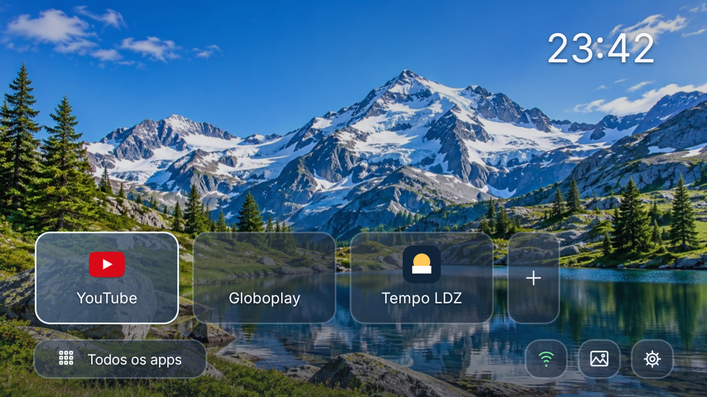
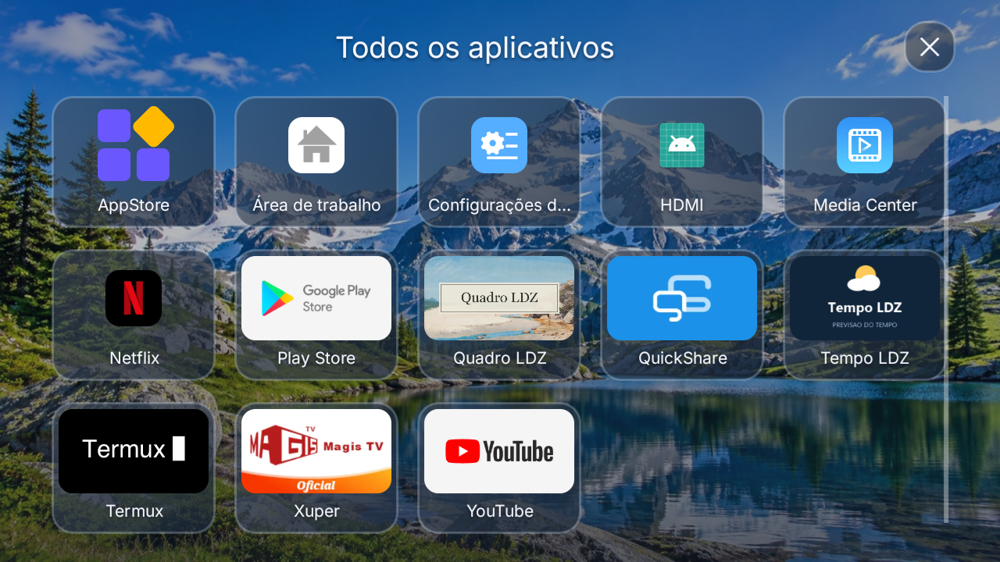
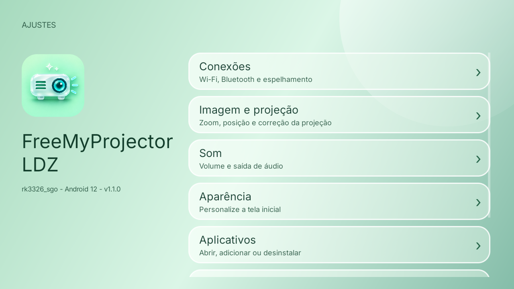
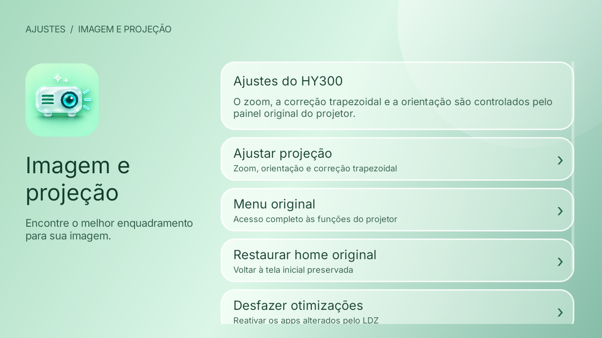
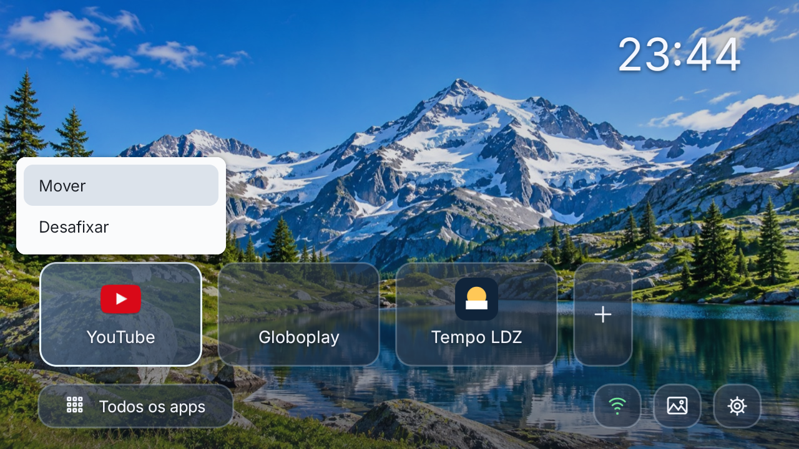
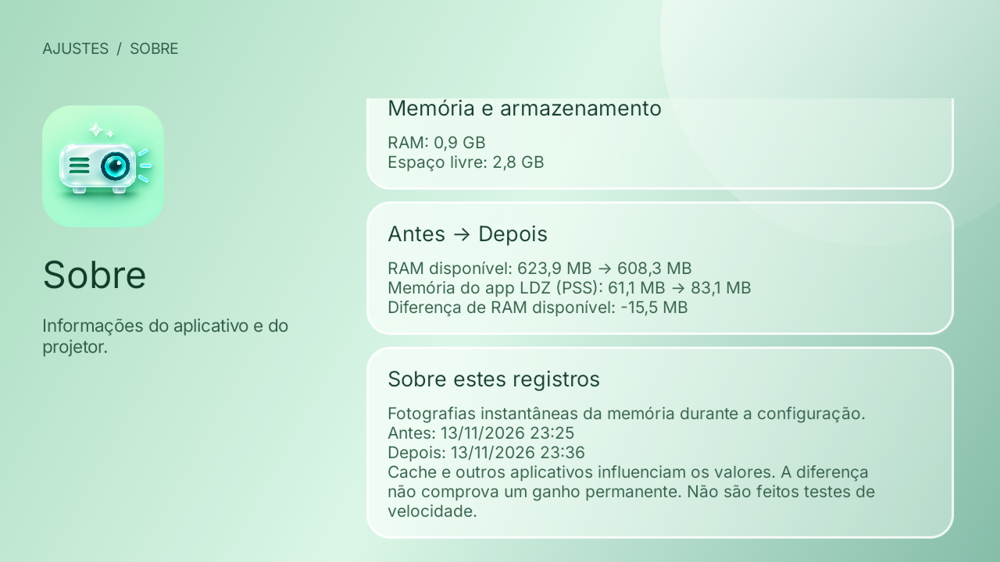

# FreeMyProjector LDZ

Tela inicial leve para projetores Android, com navegação pelo controle remoto, favoritos e acesso aos ajustes de projeção e ao menu original.

Testado em HY300 Magic Cube com firmware TXCZ e Android 12. Outros firmwares precisam de validação.

**Versão 1.1.0:** [baixar APK](https://github.com/ludezam/FreeMyProjector-LDZ/releases/latest/download/FreeMyProjector-LDZ-1.1.0.apk) · [Releases](https://github.com/ludezam/FreeMyProjector-LDZ/releases)

Favoritos editáveis, grade de aplicativos, ajustes próprios, preservação da home original e panorama instantâneo de memória. A otimização só desativa candidatos validados para o firmware; no HY300 testado, nenhum app foi desativado.

## Telas da versão 1.1.0

Capturas reais do projetor; os aplicativos exibidos dependem do que está instalado e não acompanham o APK.

| Home com paisagem e favoritos | Grade de aplicativos |
|---|---|
|  |  |
| **Ajustes com navegação pelo controle** | **Projeção e restauração da home** |
|  |  |
| **Mover ou desafixar favoritos** | **Panorama de memória antes e depois** |
|  |  |

## Instalação pelo pendrive

Baixe o APK em Releases, copie para um pendrive e abra pelo gerenciador de arquivos do projetor. Autorize a instalação por essa origem se o Android solicitar. Depois, abra **FreeMyProjector LDZ**. A preparação e a ativação como home precisam do ADB local autorizado, conforme os passos abaixo.

## Instalação por ADB

### 1. Ativar a depuração

No projetor, abra **Activity Launcher → Configurações (`com.android.tv.set`) → `system.development.DevelopmentActivity` → Iniciar atividade**. Ative as opções do desenvolvedor, **Depuração USB** e **Internet Adb**. Esse foi o caminho confirmado no firmware testado.

### 2. Descobrir a porta

Instale o Termux no projetor pelo pendrive e execute:

```sh
getprop | grep adb
```

Consulte a porta em `service.adb.tcp.port` (ou `persist.adb.tcp.port`) e o serviço `init.svc.adbd`, que deve indicar `running`. Para consultar separadamente:

```sh
getprop service.adb.tcp.port
getprop persist.adb.tcp.port
getprop init.svc.adbd
```

Não presuma a porta 5555. A porta pode variar; consulte novamente se a conexão parar de funcionar. Uma propriedade vazia, sozinha, não confirma que o ADB esteja desligado.

### 3. Conectar pelo computador

Instale o [Android SDK Platform-Tools](https://developer.android.com/tools/releases/platform-tools), conecte computador e projetor à mesma rede e consulte o IP nas configurações de rede do projetor.

No PowerShell, dentro da pasta do Platform-Tools, substitua os valores abaixo pelos dados do seu aparelho:

```powershell
$alvo = 'IP_DO_PROJETOR:PORTA_ADB'
.\adb.exe connect $alvo
.\adb.exe devices -l
```

Aceite a autorização no projetor, se solicitada. Continue quando o aparelho aparecer como `device`.

### 4. Instalar e abrir

Baixe o APK 1.1.0 em **Releases** e ajuste o caminho no comando:

```powershell
.\adb.exe -s $alvo install -r '.\FreeMyProjector-LDZ-1.1.0.apk'
.\adb.exe -s $alvo shell am start -n br.com.ldz.freemyprojector/.ProjectorHomeActivity
```

O parâmetro `-r` atualiza uma instalação com assinatura compatível. A instalação e a abertura direta foram testadas; definir a home padrão é uma etapa separada. Preserve o launcher original para poder retornar a ele.

## Primeira abertura e restauração

1. Na tela de preparação, mantenha a depuração ativa e aceite a autorização ADB do LDZ. Em **Conexão ADB**, use a detecção automática ou informe a porta consultada no Termux.
2. Escolha **Preparar projetor** para salvar a identificação da home original e registrar a memória daquele momento. O registro de recuperação fica em **Downloads/FreeMyProjector LDZ**; não é um backup completo do Android.
3. Revise os candidatos à otimização, caso existam, e escolha **Ativar FreeMyProjector**. A home original permanece instalada.
4. Para voltar, abra **Ajustes → Imagem e projeção → Restaurar home original**. **Desfazer otimizações** reativa os apps alterados pelo LDZ.

Na home, **+** adiciona favoritos e segurar **OK** permite mover ou desafixar. Use **Voltar** para sair dos menus. O panorama em **Sistema → Sobre o dispositivo** compara registros momentâneos, sem prometer ganho permanente ou medir velocidade.

## Atualizações

Nesta versão, **Buscar atualizações** ainda não consulta o GitHub. Atualize manualmente com o APK de Releases, preservando a assinatura e os dados com `install -r`. A release pública fornece a base para implementar a consulta no app pela [API da última release](https://api.github.com/repos/ludezam/FreeMyProjector-LDZ/releases/latest).

Pacote: `br.com.ldz.freemyprojector` · versão: `1.1.0` · versionCode: `7` · Android mínimo: `8.0`.

## Créditos

Derivado de [Free My TV](https://github.com/simbasjungles/free-my-tv), sob licença MIT, com adaptações do FreeMyTV LDZ. Fork não oficial; os avisos e termos originais estão em [LICENSE](LICENSE).
